# LMS Entity Relationship Diagram (ERD)

## Overview
This document provides a comprehensive Entity Relationship Diagram for the Learning Management System (LMS) component of ZedRec.

## Mermaid ERD Diagram

```mermaid
erDiagram
    users ||--o{ lms_user_courses : "enrolls in"
    users ||--o{ lms_user_section_progress : "tracks"
    users ||--o{ lms_user_answers : "submits"
    users ||--o{ lms_user_domain_performance : "performs in"
    users ||--o{ lms_activities : "logs"
    users ||--o{ lms_recommendations : "receives"
    users ||--o{ lms_deadlines : "has"
    users ||--o{ lms_certificates : "earns"
    users ||--|| lms_dashboard : "has stats"
    users ||--o{ lms_weekly_performance : "tracks"

    lms_courses ||--o{ lms_user_courses : "enrolled by"
    lms_courses ||--o{ lms_course_sections : "contains"
    lms_courses ||--o{ lms_questions : "has"
    lms_courses ||--o{ lms_course_resources : "has"
    lms_courses ||--o{ lms_activities : "referenced in"
    lms_courses ||--o{ lms_recommendations : "recommended as"
    lms_courses ||--o{ lms_deadlines : "has deadlines"
    lms_courses ||--o{ lms_certificates : "issues"

    lms_course_sections ||--o{ lms_questions : "contains"
    lms_course_sections ||--o{ lms_user_section_progress : "tracked in"

    lms_questions ||--o{ lms_user_answers : "answered in"

    lms_domains ||--o{ lms_user_domain_performance : "tracked in"

    users {
        integer uid PK "Primary Key"
        string username
        string name
        string user_email
        text password_hash
        boolean email_verified
        timestamp created_at
        timestamp updated_at
    }

    lms_courses {
        integer id PK "Primary Key"
        string title
        text description
        string icon
        integer lessons
        string duration
        string category
        string difficulty
        boolean is_active
        timestamp created_at
        timestamp updated_at
    }

    lms_domains {
        integer id PK "Primary Key"
        string name UK "Unique"
        text description
        string icon
        timestamp created_at
    }

    lms_user_courses {
        integer id PK "Primary Key"
        integer user_id FK "References users(uid)"
        integer course_id FK "References lms_courses(id)"
        integer progress "0-100"
        string status "not_started|in_progress|completed"
        timestamp started_at
        timestamp completed_at
        timestamp last_accessed_at
        timestamp created_at
        timestamp updated_at
        unique user_id_course_id "UNIQUE(user_id, course_id)"
    }

    lms_course_sections {
        integer id PK "Primary Key"
        integer course_id FK "References lms_courses(id)"
        string title
        text description
        integer order_index
        integer total_items
        timestamp created_at
    }

    lms_user_section_progress {
        integer id PK "Primary Key"
        integer user_id FK "References users(uid)"
        integer section_id FK "References lms_course_sections(id)"
        integer completed_items
        boolean is_completed
        timestamp created_at
        timestamp updated_at
        unique user_id_section_id "UNIQUE(user_id, section_id)"
    }

    lms_questions {
        integer id PK "Primary Key"
        integer course_id FK "References lms_courses(id)"
        integer section_id FK "References lms_course_sections(id) NULL"
        text question_text
        string question_type "text|multiple_choice|etc"
        jsonb options "For multiple choice questions"
        text correct_answer
        integer points
        integer order_index
        timestamp created_at
    }

    lms_user_answers {
        integer id PK "Primary Key"
        integer user_id FK "References users(uid)"
        integer question_id FK "References lms_questions(id)"
        text answer_text
        boolean is_correct
        integer points_earned
        timestamp submitted_at
        timestamp evaluated_at
        text feedback
    }

    lms_user_domain_performance {
        integer id PK "Primary Key"
        integer user_id FK "References users(uid)"
        integer domain_id FK "References lms_domains(id)"
        integer questions_answered
        integer correct_answers
        decimal accuracy_percentage
        timestamp created_at
        timestamp updated_at
        unique user_id_domain_id "UNIQUE(user_id, domain_id)"
    }

    lms_activities {
        integer id PK "Primary Key"
        integer user_id FK "References users(uid)"
        integer course_id FK "References lms_courses(id) NULL"
        string activity_type
        string title
        text description
        string icon
        timestamp created_at
    }

    lms_recommendations {
        integer id PK "Primary Key"
        integer user_id FK "References users(uid)"
        integer course_id FK "References lms_courses(id)"
        text reason
        integer priority
        boolean is_dismissed
        timestamp created_at
    }

    lms_deadlines {
        integer id PK "Primary Key"
        integer user_id FK "References users(uid)"
        integer course_id FK "References lms_courses(id) NULL"
        string title
        text description
        timestamp due_date
        boolean is_completed
        timestamp completed_at
        boolean reminder_sent
        timestamp created_at
    }

    lms_certificates {
        integer id PK "Primary Key"
        integer user_id FK "References users(uid)"
        integer course_id FK "References lms_courses(id)"
        string certificate_number UK "Unique"
        string title
        timestamp issued_at
        timestamp expiry_date
        string pdf_url
        unique user_id_course_id "UNIQUE(user_id, course_id)"
    }

    lms_course_resources {
        integer id PK "Primary Key"
        integer course_id FK "References lms_courses(id)"
        string title
        string resource_type "video|document|link|etc"
        string url
        text description
        integer order_index
        timestamp created_at
    }

    lms_dashboard {
        integer id PK "Primary Key"
        integer user_id FK "References users(uid)"
        integer total_questions
        integer correct_answers
        integer wrong_answers
        decimal overall_accuracy
        integer day_streak
        date last_activity_date
        timestamp created_at
        timestamp updated_at
        unique user_id "UNIQUE(user_id)"
    }

    lms_weekly_performance {
        integer id PK "Primary Key"
        integer user_id FK "References users(uid)"
        date date
        integer questions_answered
        integer correct_answers
        integer wrong_answers
        integer study_time_minutes
        timestamp created_at
        unique user_id_date "UNIQUE(user_id, date)"
    }
```

## Entity Descriptions

### Core Entities

#### 1. **users** (External Entity)
- **Description**: User accounts in the system
- **Primary Key**: `uid` (SERIAL/INTEGER)
- **Note**: This is the main users table from the core system

#### 2. **lms_courses**
- **Description**: Learning courses available in the system
- **Primary Key**: `id`
- **Key Attributes**: 
  - `title`, `description`, `icon`
  - `lessons` (count), `duration`, `category`, `difficulty`
  - `is_active` (soft delete flag)

#### 3. **lms_domains**
- **Description**: Learning domains/categories (e.g., "Web Development", "Data Science")
- **Primary Key**: `id`
- **Key Attributes**: `name` (unique), `description`, `icon`

### User Progress & Enrollment

#### 4. **lms_user_courses**
- **Description**: User enrollment and progress tracking for courses
- **Primary Key**: `id`
- **Foreign Keys**: 
  - `user_id` → `users(uid)`
  - `course_id` → `lms_courses(id)`
- **Key Attributes**: 
  - `progress` (0-100 percentage)
  - `status` (not_started, in_progress, completed)
  - `started_at`, `completed_at`, `last_accessed_at`
- **Constraints**: UNIQUE(user_id, course_id) - one enrollment per user per course

#### 5. **lms_course_sections**
- **Description**: Sections/modules within a course
- **Primary Key**: `id`
- **Foreign Keys**: `course_id` → `lms_courses(id)`
- **Key Attributes**: `title`, `order_index`, `total_items`

#### 6. **lms_user_section_progress**
- **Description**: User progress within course sections
- **Primary Key**: `id`
- **Foreign Keys**: 
  - `user_id` → `users(uid)`
  - `section_id` → `lms_course_sections(id)`
- **Key Attributes**: `completed_items`, `is_completed`
- **Constraints**: UNIQUE(user_id, section_id)

### Assessment & Questions

#### 7. **lms_questions**
- **Description**: Questions/assessments for courses
- **Primary Key**: `id`
- **Foreign Keys**: 
  - `course_id` → `lms_courses(id)`
  - `section_id` → `lms_course_sections(id)` (optional)
- **Key Attributes**: 
  - `question_text`, `question_type`
  - `options` (JSONB for multiple choice)
  - `correct_answer`, `points`, `order_index`

#### 8. **lms_user_answers**
- **Description**: User answers to questions
- **Primary Key**: `id`
- **Foreign Keys**: 
  - `user_id` → `users(uid)`
  - `question_id` → `lms_questions(id)`
- **Key Attributes**: 
  - `answer_text`, `is_correct`
  - `points_earned`, `feedback`
  - `submitted_at`, `evaluated_at`

### Performance Tracking

#### 9. **lms_user_domain_performance**
- **Description**: User performance metrics by learning domain
- **Primary Key**: `id`
- **Foreign Keys**: 
  - `user_id` → `users(uid)`
  - `domain_id` → `lms_domains(id)`
- **Key Attributes**: 
  - `questions_answered`, `correct_answers`
  - `accuracy_percentage`
- **Constraints**: UNIQUE(user_id, domain_id)

#### 10. **lms_dashboard**
- **Description**: Aggregated user learning statistics
- **Primary Key**: `id`
- **Foreign Keys**: `user_id` → `users(uid)`
- **Key Attributes**: 
  - `total_questions`, `correct_answers`, `wrong_answers`
  - `overall_accuracy`, `day_streak`
  - `last_activity_date`
- **Constraints**: UNIQUE(user_id) - one dashboard per user

#### 11. **lms_weekly_performance**
- **Description**: Daily/weekly performance tracking
- **Primary Key**: `id`
- **Foreign Keys**: `user_id` → `users(uid)`
- **Key Attributes**: 
  - `date`, `questions_answered`
  - `correct_answers`, `wrong_answers`
  - `study_time_minutes`
- **Constraints**: UNIQUE(user_id, date) - one record per user per day

### Activity & Engagement

#### 12. **lms_activities**
- **Description**: Learning activity log/feed
- **Primary Key**: `id`
- **Foreign Keys**: 
  - `user_id` → `users(uid)`
  - `course_id` → `lms_courses(id)` (optional)
- **Key Attributes**: `activity_type`, `title`, `description`, `icon`, `created_at`

#### 13. **lms_recommendations**
- **Description**: AI/system-generated course recommendations
- **Primary Key**: `id`
- **Foreign Keys**: 
  - `user_id` → `users(uid)`
  - `course_id` → `lms_courses(id)`
- **Key Attributes**: `reason`, `priority`, `is_dismissed`

#### 14. **lms_deadlines**
- **Description**: Course deadlines and assignments
- **Primary Key**: `id`
- **Foreign Keys**: 
  - `user_id` → `users(uid)`
  - `course_id` → `lms_courses(id)` (optional)
- **Key Attributes**: 
  - `title`, `description`, `due_date`
  - `is_completed`, `completed_at`
  - `reminder_sent`

### Certificates & Resources

#### 15. **lms_certificates**
- **Description**: Course completion certificates
- **Primary Key**: `id`
- **Foreign Keys**: 
  - `user_id` → `users(uid)`
  - `course_id` → `lms_courses(id)`
- **Key Attributes**: 
  - `certificate_number` (unique)
  - `title`, `issued_at`, `expiry_date`
  - `pdf_url`
- **Constraints**: UNIQUE(user_id, course_id) - one certificate per user per course

#### 16. **lms_course_resources**
- **Description**: Course materials (videos, documents, links)
- **Primary Key**: `id`
- **Foreign Keys**: `course_id` → `lms_courses(id)`
- **Key Attributes**: 
  - `title`, `resource_type`, `url`
  - `description`, `order_index`

## Relationship Summary

### One-to-Many Relationships
- **users** → **lms_user_courses** (1:N) - A user can enroll in multiple courses
- **users** → **lms_user_answers** (1:N) - A user can submit multiple answers
- **users** → **lms_activities** (1:N) - A user can have multiple activities
- **lms_courses** → **lms_course_sections** (1:N) - A course has multiple sections
- **lms_courses** → **lms_questions** (1:N) - A course has multiple questions
- **lms_course_sections** → **lms_questions** (1:N) - A section can have multiple questions
- **lms_questions** → **lms_user_answers** (1:N) - A question can have multiple user answers

### One-to-One Relationships
- **users** → **lms_dashboard** (1:1) - Each user has one dashboard

### Many-to-Many Relationships (via junction tables)
- **users** ↔ **lms_courses** (via `lms_user_courses`) - Users enroll in courses
- **users** ↔ **lms_domains** (via `lms_user_domain_performance`) - Users perform in domains
- **users** ↔ **lms_course_sections** (via `lms_user_section_progress`) - Users track section progress

## Key Constraints

1. **Unique Constraints**:
   - `lms_user_courses`: UNIQUE(user_id, course_id)
   - `lms_user_section_progress`: UNIQUE(user_id, section_id)
   - `lms_user_domain_performance`: UNIQUE(user_id, domain_id)
   - `lms_certificates`: UNIQUE(user_id, course_id)
   - `lms_weekly_performance`: UNIQUE(user_id, date)
   - `lms_dashboard`: UNIQUE(user_id)
   - `lms_domains`: UNIQUE(name)

2. **Foreign Key Constraints**:
   - All foreign keys use `ON DELETE CASCADE` or `ON DELETE SET NULL` as appropriate
   - User-related tables cascade delete when user is deleted
   - Course-related tables cascade delete when course is deleted

3. **Indexes**:
   - User IDs indexed for performance
   - Course IDs indexed for performance
   - Date fields indexed for time-based queries
   - Composite indexes on frequently queried combinations

## Data Flow Patterns

1. **Course Enrollment Flow**:
   - User enrolls → `lms_user_courses` created
   - Sections accessed → `lms_user_section_progress` updated
   - Questions answered → `lms_user_answers` created
   - Progress updated → `lms_user_courses.progress` updated
   - Activity logged → `lms_activities` entry created

2. **Performance Tracking Flow**:
   - Answer submitted → `lms_user_answers` created
   - Domain performance → `lms_user_domain_performance` updated
   - Weekly stats → `lms_weekly_performance` updated
   - Dashboard stats → `lms_dashboard` updated

3. **Completion Flow**:
   - Course completed → `lms_user_courses.status` = 'completed'
   - Certificate issued → `lms_certificates` entry created
   - Activity logged → `lms_activities` entry created

## Notes

- The system uses PostgreSQL with SERIAL for auto-incrementing IDs
- Some models reference `users(id)` as UUID in model definitions, but the actual schema uses `users(uid)` as INTEGER - this should be verified for consistency
- JSONB is used for flexible question options storage
- Timestamps are automatically managed with DEFAULT CURRENT_TIMESTAMP
- Soft deletes are supported via `is_active` flags where applicable
