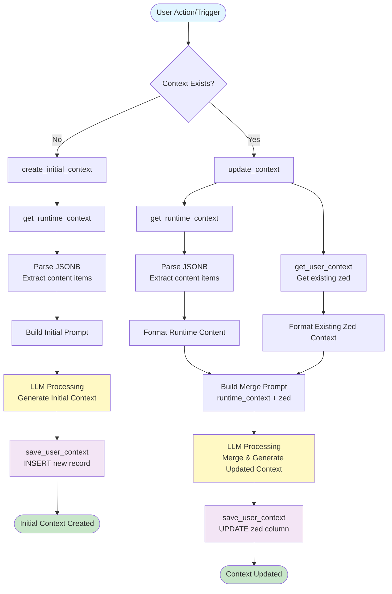
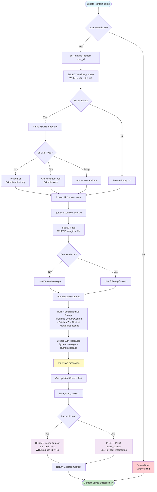
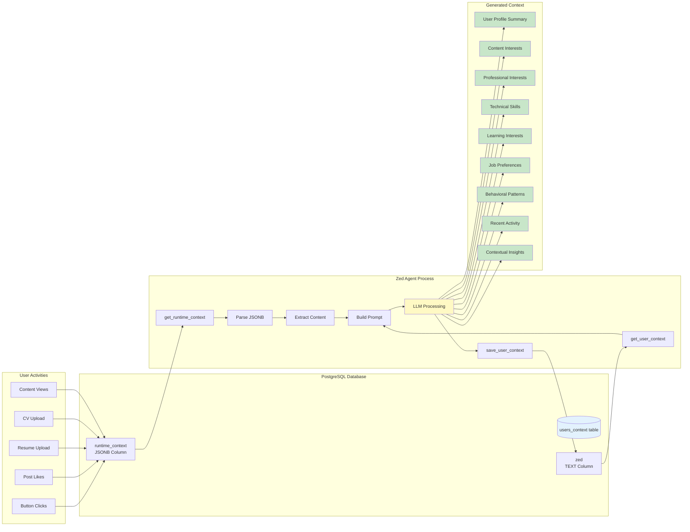
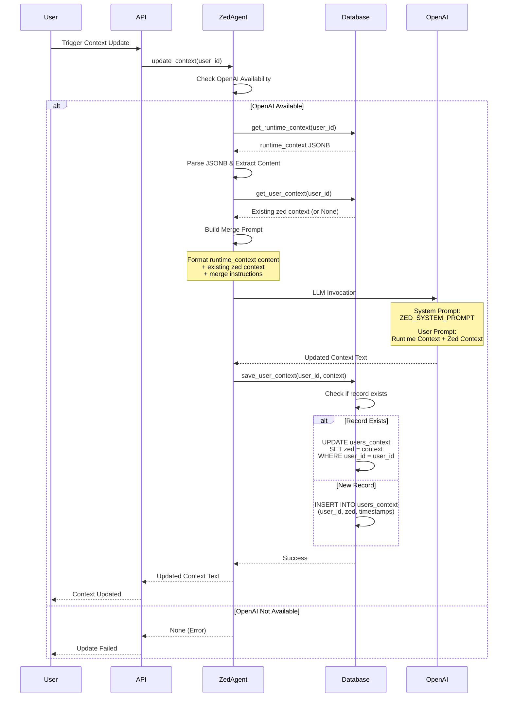
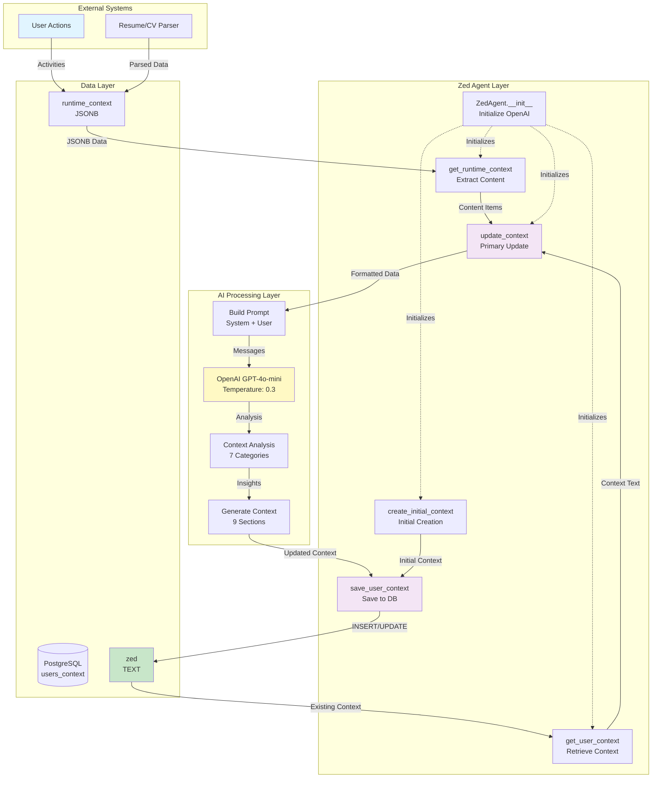
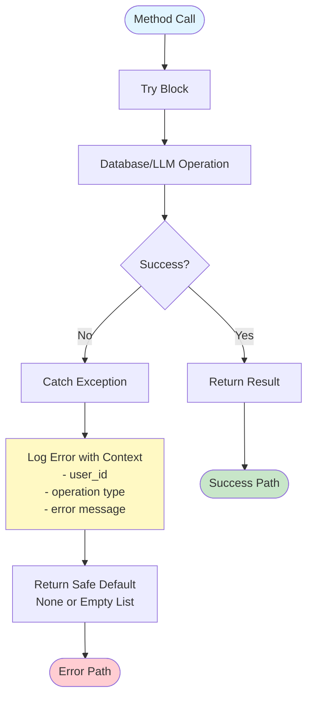

# Zed Agent - Complete Flow Diagram

## Overview Flow



## Detailed Update Context Flow



## Data Flow Architecture



## Method Call Sequence



## JSONB Parsing Logic Flow

```mermaid
flowchart TD
    Start([get_runtime_context]) --> Query[SELECT runtime_context<br/>WHERE user_id = %s]
    Query --> CheckResult{Result Exists?}
    CheckResult -->|No| ReturnEmpty[Return Empty List]
    CheckResult -->|Yes| GetJSONB[Get runtime_context JSONB]
    
    GetJSONB --> CheckType{JSONB Type?}
    
    CheckType -->|List| ProcessList[Process as List]
    ProcessList --> IterateList[Iterate Each Item]
    IterateList --> ItemType{Item Type?}
    ItemType -->|Dict with content| ExtractContentKey[Extract item['content']]
    ItemType -->|String| AddString[Add String as Content]
    ExtractContentKey --> AddToList
    AddString --> AddToList[Add to Content Items List]
    
    CheckType -->|Dict| ProcessDict[Process as Dict]
    ProcessDict --> CheckContentKey{Has 'content' key?}
    CheckContentKey -->|Yes| GetContentValue[Get content value]
    GetContentValue --> ContentType{Content Type?}
    ContentType -->|List| ExtendList[Extend with List Items]
    ContentType -->|String| AddSingle[Add Single Value]
    ExtendList --> AddToList
    AddSingle --> AddToList
    
    CheckContentKey -->|No| IterateValues[Iterate All Values]
    IterateValues --> CheckValue{Value Type?}
    CheckValue -->|String > 10 chars| AddValue[Add as Content]
    CheckValue -->|List| ExtendList2[Extend with List]
    AddValue --> AddToList
    ExtendList2 --> AddToList
    
    AddToList --> LogResult[Log Extraction Count]
    LogResult --> ReturnList[Return Content Items List]
    ReturnEmpty --> ReturnList
    ReturnList --> End([End])
    
    style Start fill:#e1f5ff
    style End fill:#c8e6c9
    style ExtractContentKey fill:#fff9c4
    style GetContentValue fill:#fff9c4
```

## Complete System Architecture



## Error Handling Flow


