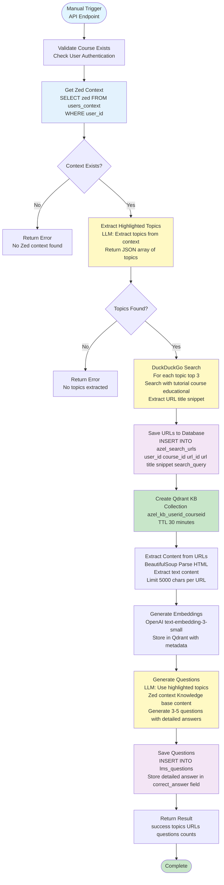
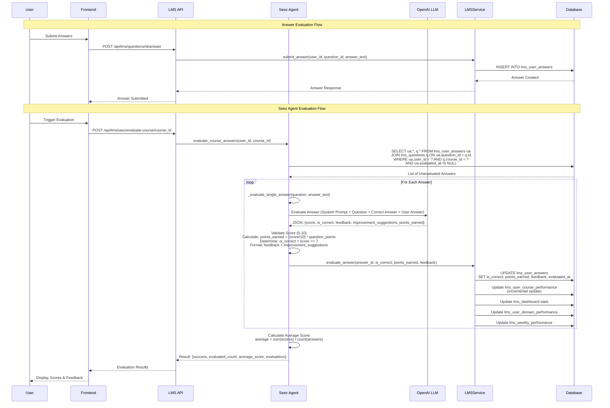
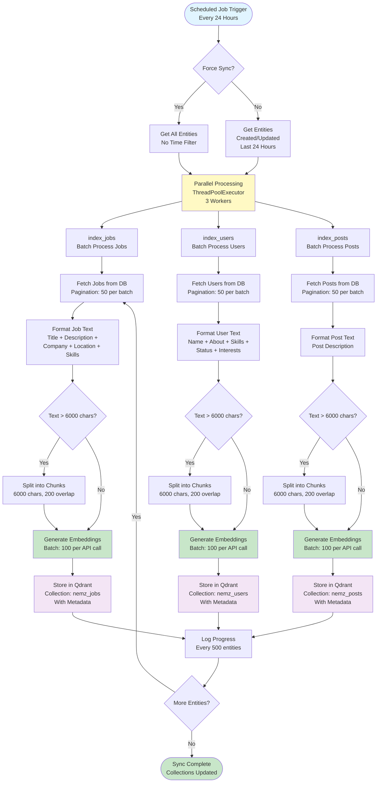
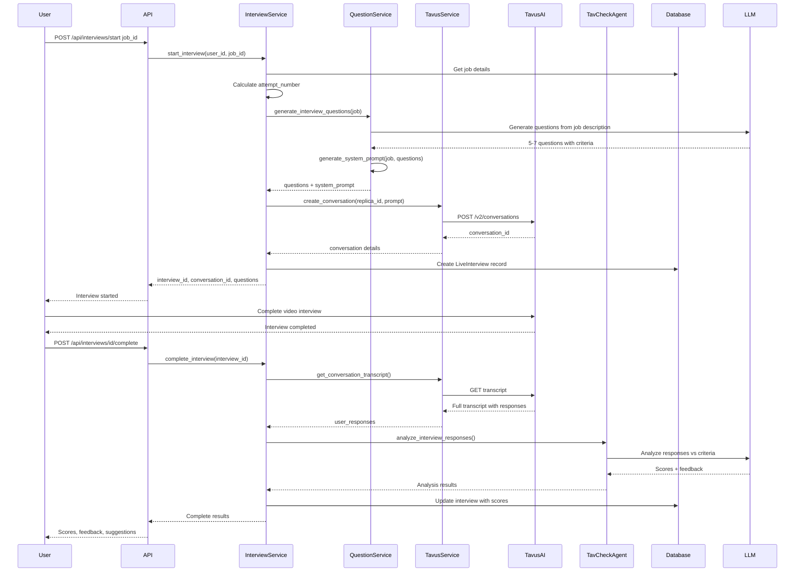
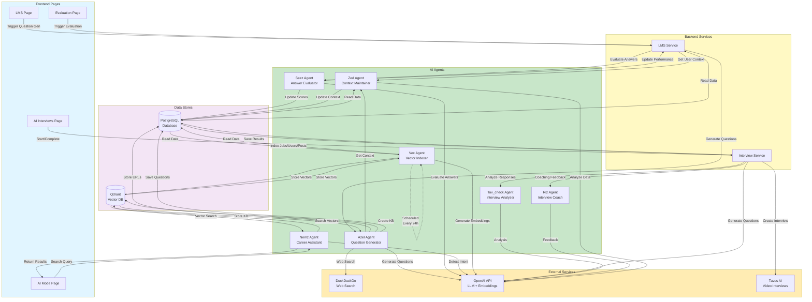

# AI Agents Flow Diagrams

This document contains all Mermaid flow diagrams for the ZedRec AI agents. These diagrams illustrate the complete workflows and data flows for each agent in the system.

## Table of Contents

1. [Zed Agent - Context Update Flow](#zed-agent-context-update-flow)
2. [Azel Agent - Question Generation Flow](#azel-agent-question-generation-flow)
3. [Seez Agent - Answer Evaluation Flow](#seez-agent-answer-evaluation-flow)
4. [Vec Agent - Vector Database Population Flow](#vec-agent-vector-database-population-flow)
5. [Nemz Agent - Career Assistant Search Flow](#nemz-agent-career-assistant-search-flow)
6. [Riz Agent - Interview Flow (Flowchart)](#riz-agent-interview-flow-flowchart)
7. [Riz Agent - Interview Sequence (Sequence Diagram)](#riz-agent-interview-sequence-sequence-diagram)
8. [Complete Agent Ecosystem Overview](#complete-agent-ecosystem-overview)

---

## Zed Agent - Context Update Flow

**Purpose:** Shows how Zed Agent maintains and updates user context from runtime activities.

```mermaid
flowchart TD
    Start([User Clicks Button<br/>e.g., Like Post, View Job, Upload Resume]) --> Store[Store Activity in<br/>runtime_context JSONB<br/>users_context table]
    
    Store --> Trigger[Trigger Context Update<br/>update_context user_id]
    
    Trigger --> GetRT[get_runtime_context<br/>Extract content from JSONB<br/>WHERE user_id = user_id]
    
    GetRT --> Parse[Parse JSONB Structure<br/>Extract items with key='content'<br/>Handle: List, Dict, Nested]
    
    Parse --> GetZed[get_user_context<br/>Retrieve existing zed context<br/>WHERE user_id = user_id]
    
    GetZed --> Format[Format Content<br/>Runtime Context Items<br/>+ Existing Zed Context]
    
    Format --> BuildPrompt[Build Comprehensive Prompt<br/>System Prompt: ZED_SYSTEM_PROMPT<br/>User Prompt: Runtime + Zed + Instructions]
    
    BuildPrompt --> LLM[OpenAI GPT-4o-mini<br/>Analyze & Merge Context<br/>Generate Updated Context]
    
    LLM --> Analyze[AI Analysis<br/>7 Information Categories<br/>9 Section Document Structure]
    
    Analyze --> Generate[Generate Comprehensive Context<br/>User Profile, Interests, Skills,<br/>Preferences, Patterns, Insights]
    
    Generate --> Save[save_user_context<br/>UPDATE users_context<br/>SET zed = new_context<br/>WHERE user_id = user_id]
    
    Save --> End([Context Updated in zed Column<br/>Ready for Next Update])
    
    style Start fill:#e1f5ff
    style Store fill:#fff9c4
    style GetRT fill:#e3f2fd
    style GetZed fill:#e3f2fd
    style LLM fill:#fff9c4
    style Analyze fill:#c8e6c9
    style Save fill:#f3e5f5
    style End fill:#c8e6c9
```



---

## Azel Agent - Question Generation Flow

**Purpose:** Illustrates the complete process of generating personalized course questions using user context, web search, and knowledge bases.



---

## Seez Agent - Answer Evaluation Flow

**Purpose:** Shows the sequence of answer evaluation, scoring, and performance updates.



---

## Vec Agent - Vector Database Population Flow

**Purpose:** Shows how Vec Agent indexes jobs, users, and posts into Qdrant vector database.



---

## Nemz Agent - Career Assistant Search Flow

**Purpose:** Illustrates how Nemz Agent detects query intent and searches across jobs, profiles, and posts.

```mermaid
flowchart TD
    Start([User Query<br/>Frontend Request]) --> CheckType{search_type<br/>Provided?}
    
    CheckType -->|No| DetectIntent[Determine Query Intent<br/>LLM: QUERY_INTENT_PROMPT<br/>Analyze Natural Language]
    CheckType -->|Yes| UseType[Use Provided Type]
    
    DetectIntent --> ParseIntent[Parse LLM Response<br/>Extract search_type<br/>jobs/profiles/posts/all]
    ParseIntent --> UseType
    
    UseType --> CheckIntent{search_type?}
    
    CheckIntent -->|jobs| SearchJobs[Search Jobs Collection<br/>nemz_jobs]
    CheckIntent -->|profiles| SearchProfiles[Search Profiles Collection<br/>nemz_users]
    CheckIntent -->|posts| SearchPosts[Search Posts Collection<br/>nemz_posts]
    CheckIntent -->|all| ParallelSearch[Parallel Search<br/>All Three Collections<br/>ThreadPoolExecutor]
    
    ParallelSearch --> SearchJobs
    ParallelSearch --> SearchProfiles
    ParallelSearch --> SearchPosts
    
    SearchJobs --> EmbedQuery1[Generate Query Embedding<br/>OpenAI text-embedding-3-small]
    SearchProfiles --> EmbedQuery2[Generate Query Embedding<br/>OpenAI text-embedding-3-small]
    SearchPosts --> EmbedQuery3[Generate Query Embedding<br/>OpenAI text-embedding-3-small]
    
    EmbedQuery1 --> VectorSearch1[Vector Similarity Search<br/>Qdrant: Cosine Distance<br/>Top K Results]
    EmbedQuery2 --> VectorSearch2[Vector Similarity Search<br/>Qdrant: Cosine Distance<br/>Top K Results]
    EmbedQuery3 --> VectorSearch3[Vector Similarity Search<br/>Qdrant: Cosine Distance<br/>Top K Results]
    
    VectorSearch1 --> DedupeJobs[Deduplicate by job_id<br/>Keep Best Match Score<br/>Per Entity]
    VectorSearch2 --> DedupeProfiles[Deduplicate by user_id<br/>Keep Best Match Score<br/>Per Entity]
    VectorSearch3 --> DedupePosts[Deduplicate by post_id<br/>Keep Best Match Score<br/>Per Entity]
    
    DedupeJobs --> RankJobs[Rank by Match Score<br/>Descending Order]
    DedupeProfiles --> RankProfiles[Rank by Match Score<br/>Descending Order]
    DedupePosts --> RankPosts[Rank by Match Score<br/>Descending Order]
    
    RankJobs --> Combine[Combine Results<br/>jobs + profiles + posts]
    RankProfiles --> Combine
    RankPosts --> Combine
    
    Combine --> FormatResponse[Format Response<br/>query, search_type,<br/>jobs[], profiles[], posts[],<br/>total_results]
    
    FormatResponse --> Return([Return to Frontend<br/>Display Results])
    
    style Start fill:#e1f5ff
    style DetectIntent fill:#fff9c4
    style ParallelSearch fill:#fff9c4
    style EmbedQuery1 fill:#c8e6c9
    style EmbedQuery2 fill:#c8e6c9
    style EmbedQuery3 fill:#c8e6c9
    style VectorSearch1 fill:#e3f2fd
    style VectorSearch2 fill:#e3f2fd
    style VectorSearch3 fill:#e3f2fd
    style Combine fill:#f3e5f5
    style Return fill:#c8e6c9
```

---

## Riz Agent - Interview Flow (Flowchart)

**Purpose:** Complete flowchart showing the interview process from start to completion with RizAgent coaching feedback, including file access and database operations.

```mermaid
flowchart TD
    Start([User Starts Interview<br/>POST /api/interviews/start]) --> GetJob[Get Job Details<br/>File: backend/services/interview_service.py<br/>DB: SELECT FROM job_postings<br/>WHERE job_id<br/>Columns: title, description, company_name,<br/>location, job_type, skills_required]
    
    GetJob --> CalcAttempt[Calculate Attempt Number<br/>File: backend/services/interview_service.py<br/>DB: SELECT COUNT FROM live_interviews<br/>WHERE user_id AND job_id<br/>Returns: attempt_number]
    
    CalcAttempt --> GenQuestions[Generate Interview Questions<br/>File: backend/services/interview_question_service.py<br/>LLM: OpenAI GPT-4o-mini<br/>Input: Job description from job_postings<br/>Output: 5-7 questions JSON array<br/>with question_text, question_type,<br/>answer_criteria, expected_key_points,<br/>difficulty_level]
    
    GenQuestions --> GenPrompt[Generate System Prompt<br/>File: backend/services/interview_question_service.py<br/>Method: generate_system_prompt<br/>Includes: Job context + Questions<br/>+ Interview instructions]
    
    GenPrompt --> CreateTavus[Create Tavus Conversation<br/>File: backend/services/tavus_service.py<br/>External: POST /v2/conversations<br/>Params: replica_id, system_prompt<br/>Response: conversation_id, status]
    
    CreateTavus --> GetConvId[Get conversation_id<br/>File: backend/services/tavus_service.py<br/>Extract from Tavus API response]
    
    GetConvId --> SaveInterview[Save Interview Record<br/>File: backend/services/interview_service.py<br/>DB: INSERT INTO live_interviews<br/>Columns Saved:<br/>- user_id<br/>- job_id<br/>- tavus_conversation_id<br/>- tavus_response JSONB<br/>- questions JSONB<br/>- attempt_number<br/>- status: 'in_progress'<br/>- started_at TIMESTAMP]
    
    SaveInterview --> ReturnStart([Return Interview Details<br/>interview_id, conversation_id<br/>Questions to Frontend])
    
    ReturnStart --> UserCompletes([User Completes<br/>Video Interview<br/>via Tavus])
    
    UserCompletes --> CompleteAPI([User Calls<br/>POST /api/interviews/id/complete])
    
    CompleteAPI --> GetInterview[Get Interview Record<br/>File: backend/services/interview_service.py<br/>DB: SELECT FROM live_interviews<br/>WHERE interview_id<br/>Load: questions, tavus_conversation_id]
    
    GetInterview --> GetTranscript[Get Interview Transcript<br/>File: backend/services/tavus_service.py<br/>External: GET /v2/conversations/id/transcript<br/>Returns: Full transcript with<br/>questions and responses]
    
    GetTranscript --> ExtractResponses[Extract User Responses<br/>File: backend/services/interview_service.py<br/>Method: _extract_user_responses<br/>Parse transcript and map<br/>responses to questions]
    
    ExtractResponses --> GetJobDetails[Get Job Details for Context<br/>File: backend/services/interview_service.py<br/>DB: SELECT FROM job_postings<br/>WHERE job_id<br/>Load: title, description, company_name]
    
    GetJobDetails --> TavCheck[Tav_check_agent Analysis<br/>File: backend/agents/Tav_check_agent.py<br/>LLM: OpenAI GPT-4o-mini<br/>Input: questions, user_responses,<br/>job_context<br/>Output: Analysis JSON with scores<br/>and feedback]
    
    TavCheck --> CalcScores[Calculate Scores<br/>File: backend/agents/Tav_check_agent.py<br/>Calculates:<br/>- overall_score 0-100<br/>- technical_score<br/>- communication_score<br/>- problem_solving_score<br/>- domain_knowledge_score]
    
    CalcScores --> GenFeedback[Generate Feedback<br/>File: backend/agents/Tav_check_agent.py<br/>Generates:<br/>- detailed_feedback TEXT<br/>- strengths array<br/>- weaknesses array<br/>- improvement_suggestions array]
    
    GenFeedback --> CheckRiz{RizAgent<br/>Available?}
    
    CheckRiz -->|Yes| RizFeedback[RizAgent Feedback<br/>File: backend/agents/Riz_agent.py<br/>LLM: OpenAI GPT-4o-mini<br/>Method: generate_feedback<br/>Input: job_context, questions,<br/>user_responses, Tav_check analysis<br/>Output: JSON with:<br/>- summary<br/>- strengths array<br/>- weaknesses array<br/>- recommendations array<br/>- next_steps array]
    CheckRiz -->|No| SkipRiz[Skip Riz Feedback<br/>Log warning]
    
    RizFeedback --> SaveResults[Save All Results<br/>File: backend/services/interview_service.py<br/>DB: UPDATE live_interviews<br/>WHERE interview_id<br/>Columns Updated:<br/>- user_responses JSONB<br/>- overall_score INTEGER<br/>- score_breakdown JSONB<br/>- feedback TEXT<br/>- riz_feedback JSONB<br/>- status: 'completed'<br/>- completed_at TIMESTAMP]
    SkipRiz --> SaveResults
    
    SaveResults --> ReturnComplete([Return Complete Results<br/>Scores, Feedback,<br/>Riz Coaching to Frontend])
    
    style Start fill:#e1f5ff
    style GenQuestions fill:#fff9c4
    style CreateTavus fill:#fff9c4
    style TavCheck fill:#fff9c4
    style RizFeedback fill:#c8e6c9
    style SaveResults fill:#f3e5f5
    style ReturnComplete fill:#c8e6c9
```



### File Access Details

**Backend Files Accessed:**
- `backend/routers/interviews.py` - API endpoint handlers
- `backend/services/interview_service.py` - Main orchestration service
- `backend/services/interview_question_service.py` - Question generation
- `backend/services/tavus_service.py` - Tavus AI integration
- `backend/agents/Tav_check_agent.py` - Response analysis
- `backend/agents/Riz_agent.py` - Coaching feedback generation
- `backend/models/orm/live_interview.py` - Database model
- `backend/models/orm/job_posting.py` - Job model

**External Services:**
- Tavus AI API (`/v2/conversations`)
- OpenAI API (LLM for questions, analysis, feedback)

### Database Operations

**Table: `live_interviews`**

**On Interview Start (INSERT):**
- `user_id` (INTEGER, FK to users.uid)
- `job_id` (INTEGER, FK to job_postings.job_id)
- `tavus_conversation_id` (VARCHAR(255))
- `tavus_response` (JSONB) - Full Tavus API response
- `questions` (JSONB) - Generated questions array
- `attempt_number` (INTEGER) - Calculated attempt count
- `status` (VARCHAR(20)) - Set to 'in_progress'
- `started_at` (TIMESTAMP) - Current timestamp

**On Interview Complete (UPDATE):**
- `user_responses` (JSONB) - Extracted from transcript
- `overall_score` (INTEGER) - 0-100 score from Tav_check
- `score_breakdown` (JSONB) - Category scores:
  - `technical_score`
  - `communication_score`
  - `problem_solving_score`
  - `domain_knowledge_score`
- `feedback` (TEXT) - Detailed feedback from Tav_check
- `riz_feedback` (JSONB) - Coaching feedback structure:
  - `summary` (TEXT)
  - `strengths` (array)
  - `weaknesses` (array)
  - `recommendations` (array)
  - `next_steps` (array)
- `status` (VARCHAR(20)) - Updated to 'completed'
- `completed_at` (TIMESTAMP) - Completion timestamp

**Table: `job_postings` (READ ONLY)**
- Used to get job context for question generation and analysis
- Columns accessed: `job_id`, `title`, `description`, `company_name`, `location`, `job_type`, `skills_required`

---

## Riz Agent - Interview Sequence (Sequence Diagram)

**Purpose:** Sequence diagram showing the interaction between components during the interview process.



---

## Complete Agent Ecosystem Overview

**Purpose:** High-level overview showing how all agents interact with frontend, backend services, data stores, and external services.



---

## Notes

- All diagrams use Mermaid syntax and can be rendered in any Markdown viewer that supports Mermaid (GitHub, GitLab, VS Code with Mermaid extension, etc.)
- The diagrams show the complete data flow and decision points for each agent
- Color coding:
  - **Blue (#e1f5ff)**: Start/Entry points
  - **Yellow (#fff9c4)**: LLM/AI processing steps
  - **Green (#c8e6c9)**: Success/completion states
  - **Purple (#f3e5f5)**: Data storage operations
  - **Light Blue (#e3f2fd)**: Data retrieval operations
